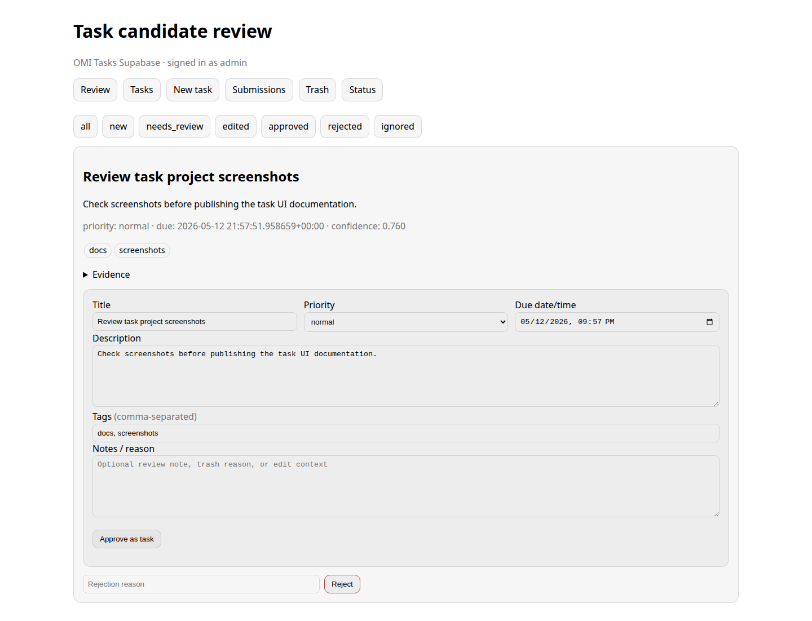
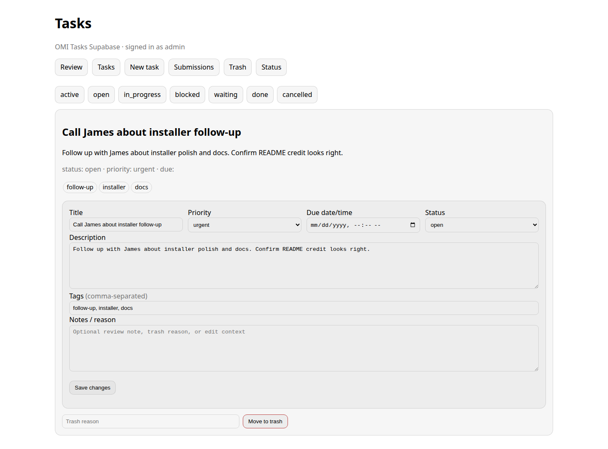

# OMI-Tasks-Supabase

Self-hosted review UI and Postgres schema for Omi action items you approve into tasks.

Omi items stay in a review queue until you approve them. The web UI uses HTTP Basic Auth, so serve it over HTTPS when it is reachable beyond localhost, and keep transcripts and tasks on a host you control.

## What it does

- Loads Omi Developer API action items into `tasks.task_candidates` when you ask it to. Approving a candidate creates a row in `tasks.task_items`.
- On each candidate you can approve it after editing the title, description, due date, priority, and tags, reject it with a reason, or read the stored evidence JSON.
- Lets you create a task by hand, update its status, and move it to trash. Trash sets `status` to `trashed`. Restore sets it back to `open`.
- Records those review and task changes, plus API intake and Omi loads, in `tasks.audit_log`.
- Accepts candidates from other tools at `POST /tasks/api/candidates`, using the same Basic Auth as the UI.

Statuses are `open`, `in_progress`, `blocked`, `waiting`, `done`, `cancelled`, and `trashed`. Priorities are `low`, `normal`, `high`, and `urgent`. Tags are comma-separated and recorded in `tasks.tag_registry`.

Home links to the review queue, tasks, a new-task form, Omi load, submissions, and trash. It shows counts for the review queue, active tasks, submissions, and trash. Submissions lists recent candidates and audit rows. Status shows counts by state.





## Requirements

- Docker Engine
- Docker Compose plugin

The installer is a bash script for a Linux host. Optional: a TLS reverse proxy, a Supabase project if you want to run the same SQL there, and n8n for the included candidate-intake workflow.

## Setup and usage

From a checkout of this repo:

```bash
./install.sh install
```

The installer checks Docker, creates `website/taskReviewUi/.env` when that file is missing, starts Postgres, applies `supabase/sql/001_omi_tasks_supabase_setup.sql`, and builds the web UI on port `8098`.

Open http://localhost:8098/review and sign in with the username and password in `website/taskReviewUi/.env`. On another machine, use the server address in place of `localhost`.

```bash
./install.sh install --non-interactive   # writes a generated UI password and skips prompts
./install.sh install --with-n8n          # also starts n8n at http://localhost:5679
./install.sh status
./install.sh stop --with-n8n             # stop leaves database data in place
./install.sh start --with-n8n            # brings an existing stack back up
./install.sh uninstall                   # asks you to confirm before deleting data
./install.sh uninstall --yes --keep-env  # unattended cleanup; --keep-env retains .env
```

To load live Omi action items, set `OMI_API_BASE` (normally `https://api.omi.me`) and add your Omi Developer API key as `OMI_API_KEY` in `website/taskReviewUi/.env`. Then open **Load from Omi** in the UI. Leave that key out of git. A commented template is in `website/taskReviewUi/.env.example`.

To apply the schema yourself, on local Postgres or in Supabase:

```bash
psql "$DATABASE_URL" -v ON_ERROR_STOP=1 -f supabase/sql/001_omi_tasks_supabase_setup.sql
```

Field notes for candidate rows are in `docs/importGuide.md`. A starter n8n export lives at `n8n/workflows/omi-tasks-candidate-intake.workflow.json`. Import it, attach an HTTP Basic Auth credential that matches the task UI, and activate the workflow when you want the webhook.

`./scripts/validate_package.sh` checks syntax and expected files. If `DATABASE_URL` is set and `psql` is installed, it also applies the schema.

## License

MIT. See [LICENSE](LICENSE).
